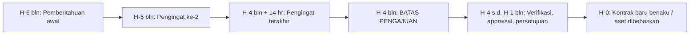
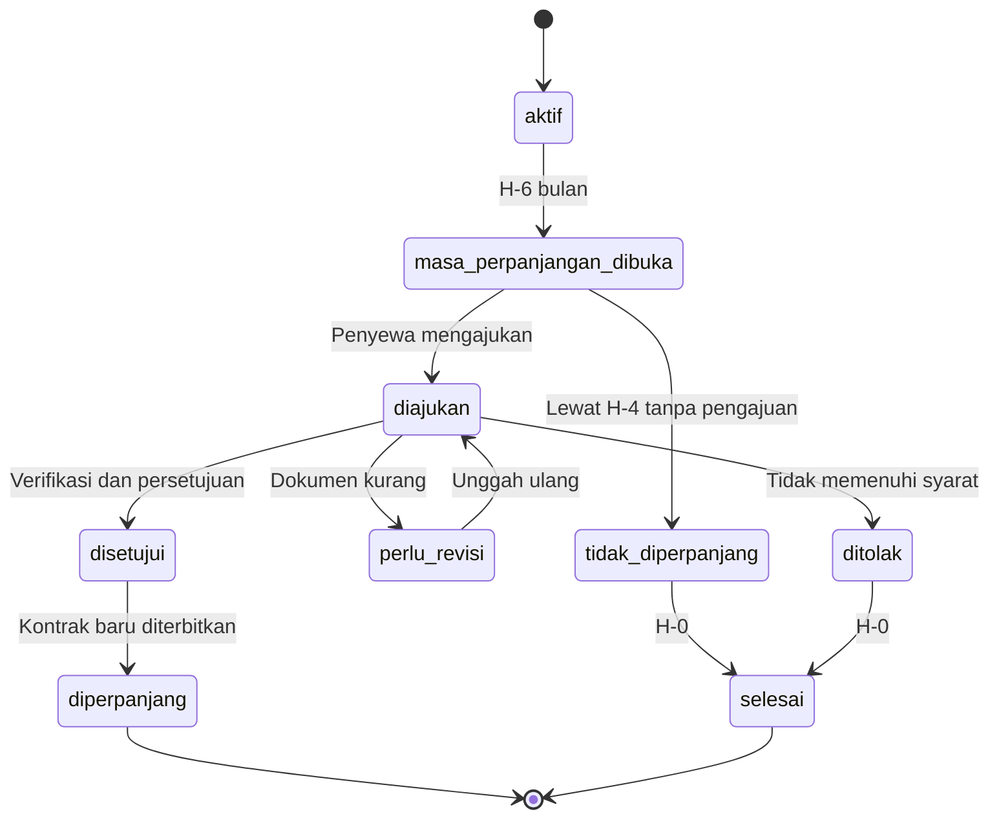

# Rekomendasi Mekanisme Perpanjangan Sewa BMD (H-4 Bulan)

## 1. Ringkasan Eksekutif

Kewajiban "mengajukan perpanjangan paling lambat 4 bulan sebelum masa sewa berakhir" sebaiknya **tidak diperlakukan sebagai sekadar notifikasi**, tetapi sebagai **proses bisnis tersendiri** (*workflow* perpanjangan) yang:

1. **Proaktif**: sistem yang mengingatkan, bukan admin yang mengejar penyewa.
2. **Terukur**: setiap kontrak punya status yang jelas dan tenggat yang dihitung otomatis.
3. **Berkonsekuensi**: lewat H-4 tanpa pengajuan → otomatis dianggap *tidak memperpanjang*, aset disiapkan untuk ditawarkan kembali.
4. **Memakai ulang yang sudah ada**: alur unggah dokumen + verifikasi admin pada booking dipakai lagi.

## 2. Kondisi Aplikasi Saat Ini (Hasil Telaah Kode)

| Komponen | Kondisi | Catatan |
|---|---|---|
| `bmd:check-expiring-leases` (harian 01:00) | Sudah ada | Memberi status `peringatan_jatuh_tempo` pada **H-6 bulan**, dan `selesai` setelah lewat tanggal akhir |
| `AssetPemanfaatan` | Sudah ada | Punya `tanggal_akhir` & `status_perpanjangan`, tetapi **tidak terhubung ke akun user penyewa** |
| Notifikasi (email/WA) | **Belum ada** | `app/Notifications` & `app/Mail` belum ada; peringatan hanya tercatat di log |
| Batas H-4 bulan | **Belum ada** | Tidak ada tenggat pengajuan maupun konsekuensinya |
| Alur dokumen & verifikasi | Sudah ada (booking) | Dapat dijadikan pola untuk dokumen perpanjangan |

> [!IMPORTANT]
> Gap terbesar: kontrak (`AssetPemanfaatan`) belum terhubung ke **akun penyewa**. Tanpa ini, penyewa tidak bisa melihat kontraknya di portal maupun mengajukan perpanjangan secara mandiri.

## 3. Timeline yang Direkomendasikan

| Titik waktu | Aksi sistem | Penerima |
|---|---|---|
| **H-6 bulan** | Status `masa_perpanjangan_dibuka`; tombol "Ajukan Perpanjangan" muncul di portal | Penyewa + Admin |
| **H-5 bulan** | Pengingat ke-2 (jika belum mengajukan) | Penyewa |
| **H-4 bln + 14 hari** | Pengingat terakhir + penjelasan konsekuensi | Penyewa + Admin |
| **H-4 bulan** | Tombol ditutup. Belum mengajukan → `tidak_diperpanjang` | Admin (rekap) |
| **H-4 → H-0** | Verifikasi dokumen, penilaian ulang tarif, persetujuan/perjanjian | Admin |
| **H-0** | Disetujui → kontrak baru aktif. Tidak → aset kembali `tersedia` | Sistem |

> [!TIP]
> Simpan angka 6 / 5 / 4 bulan sebagai **parameter konfigurasi** (mis. `config/bmd.php` atau tabel pengaturan), bukan *hard-code*. Regulasi dan kebijakan pimpinan bisa berubah.

## 4. Siklus Status Kontrak

## 5. Desain Data (Usulan)

**a. Hubungkan kontrak ke penyewa**: tambah `user_id` (nullable) pada `asset_pemanfaatans`, serta `booking_id` bila kontrak lahir dari booking di aplikasi.

> [!IMPORTANT]
> Kontrak **hanya terbentuk setelah PKS terbit** (booking `contract_signed` + dokumen `REQ_PERJANJIAN_SEWA` terverifikasi), dibuat otomatis oleh sistem. Peminat yang belum ber-PKS tidak memiliki kontrak dan tidak melihat menu "Kontrak Saya". Rincian teknis: poin **7a** pada `rencana_perbaikan_aplikasi.md`.

**b. Tabel baru `lease_renewals` (pengajuan perpanjangan)**

| Kolom | Fungsi |
|---|---|
| `asset_pemanfaatan_id`, `user_id` | Kontrak & pengaju |
| `kode_pengajuan` | Mis. `PP-202611-0001` (pola sama dengan `kode_booking`) |
| `durasi_diajukan_tahun`, `rencana_peruntukan` | Isi permohonan |
| `status` | Sesuai diagram di atas |
| `diajukan_pada`, `batas_pengajuan` | Bukti kepatuhan H-4 |
| `tarif_baru`, `nomor_persetujuan`, `catatan_admin` | Hasil proses |
| `kontrak_baru_id` | Tautan ke `AssetPemanfaatan` baru setelah disetujui |

**c. Dokumen perpanjangan**: pakai ulang `BookingRequirement` dengan kategori baru `perpanjangan`, mis. surat permohonan perpanjangan, bukti lunas sewa periode berjalan, laporan pemanfaatan/kondisi aset, KTP/NIB terbaru.

> [!NOTE]
> Lebih baik membuat record kontrak **baru** saat perpanjangan disetujui (bukan mengubah `tanggal_akhir` kontrak lama), agar riwayat sewa tetap utuh untuk audit BPK/Inspektorat.

## 6. Aturan Bisnis Penting

1. **Syarat boleh mengajukan**: tidak ada tunggakan termin pembayaran. Jika menunggak → tombol tampil tetapi diblokir dengan pesan jelas.
2. **Pengajuan dikunci setelah H-4**; admin dapat membuka kembali hanya dengan **alasan tertulis** yang tercatat di log audit (kasus *force majeure*).
3. **Tarif dievaluasi ulang**: perpanjangan tidak otomatis memakai tarif lama.
4. **Aset tidak boleh "dobel"**: selama status `diajukan`, aset tidak tampil sebagai `tersedia` di katalog.
5. **Lewat H-4 tanpa pengajuan**: aset ditandai "akan tersedia per tanggal X" di katalog agar peminat baru bisa bersiap.

## 7. Notifikasi Multi-Kanal

| Kanal | Rekomendasi |
|---|---|
| **In-app** (portal & panel Filament) | Wajib; Filament mendukung *database notifications* |
| **Email** | Wajib; Laravel Notifications + *queue* |
| **WhatsApp** | Sangat disarankan (data `nomor_whatsapp` sudah ada) via gateway resmi |

Setiap notifikasi dicatat sebagai **bukti bahwa penyewa sudah diingatkan**, penting jika terjadi sengketa.

## 8. Tampilan yang Disarankan

- **Portal penyewa, "Kontrak Saya"**: kartu kontrak dengan hitung mundur ke batas H-4, badge warna (hijau > 6 bln, kuning 6–4 bln, merah < 4 bln), tombol "Ajukan Perpanjangan".
- **Panel admin**:
  - Widget dashboard: *Masuk masa perpanjangan*, *Sudah mengajukan*, *Lewat H-4 tanpa pengajuan*, *Menunggu verifikasi*.
  - Resource "Pengajuan Perpanjangan" dengan tombol Verifikasi / Minta Revisi / Setujui / Tolak (pola sama dengan dokumen booking).

## 9. Roadmap Implementasi Bertahap

| Fase | Lingkup | Nilai |
|---|---|---|
| **1. Fondasi** | `user_id` pada kontrak, parameter konfigurasi, perluas `check-expiring-leases` dengan status H-4 | Kepatuhan tenggat tercatat |
| **2. Pengajuan mandiri** | Tabel `lease_renewals`, portal "Kontrak Saya", unggah dokumen | Penyewa mengajukan sendiri |
| **3. Verifikasi admin** | Resource Filament, alur revisi/persetujuan, kontrak baru otomatis | Proses end-to-end |
| **4. Notifikasi** | Email + in-app, lalu WhatsApp | Mengurangi kelalaian penyewa |
| **5. Pelaporan** | Rekap & ekspor tingkat kepatuhan perpanjangan | Bahan laporan pimpinan/audit |

Setiap fase disertai *feature test* (simulasi tanggal dengan `Carbon::setTestNow()` untuk H-6, H-4, H-0).

## 10. Keputusan yang Perlu Anda Tetapkan

1. **Dasar hukum H-4 bulan**: kode saat ini merujuk H-6 bulan (Permendagri 19/2016). Pastikan rujukan resmi H-4 (Pergub/SOP UPTD?) agar teks di aplikasi akurat.
2. **Apakah H-6 tetap dipakai** sebagai awal pemberitahuan, dengan H-4 sebagai batas akhir? (rekomendasi: ya)
3. **Kontrak lama hasil impor Excel**: bagaimana menautkannya ke akun penyewa (undangan via email/WA, atau akun dibuatkan admin)?
4. **Kanal WhatsApp**: apakah sudah ada gateway resmi yang boleh dipakai instansi?
5. **Kebijakan setelah lewat H-4**: kunci mutlak, atau boleh dibuka admin dengan alasan tertulis?
