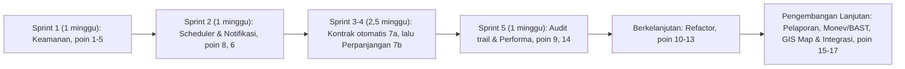

# Rencana Teknis Perbaikan Aplikasi SIP Aset Jabar

**Repositori:** github.com/Denda17/pemanfaatan · **Commit acuan:** `4434939` · **Tanggal audit:** 26 November 2026
**Stack:** Laravel 13 · PHP 8.4 · Filament · PostgreSQL 16 · Docker (nginx + php-fpm)

## Ringkasan Hasil Audit

| Aspek | Hasil |
|---|---|
| Test suite | ✅ 69 tes lulus (524 assertions) |
| Log error | ✅ Bersih (hanya error migrasi lama yang sudah diperbaiki) |
| Dependency audit | ❌ 1 kerentanan (`symfony/routing`, CVE-2026-118516) |
| Rate limiting | ❌ Tidak ada di seluruh rute |
| Otorisasi terpusat (Policy) | ❌ Belum ada |
| Notifikasi | ❌ Belum ada (`MAIL_MAILER=log`) |
| Scheduler & queue worker | ❌ Tidak berjalan di Docker |

| Prioritas | Jumlah | Estimasi total |
|---|---|---|
| 🔴 Tinggi (Keamanan) | 5 | ± 3–4 hari |
| 🟠 Menengah (Fungsi bisnis) | 4 | ± 3–4 minggu |
| 🟡 Rendah (Kualitas kode) | 5 | Bertahap |

> [!NOTE]
> Estimasi bersifat indikatif untuk 1 developer dan sudah termasuk penulisan *feature test*.

---

## 🔴 PRIORITAS TINGGI — Keamanan

### 1. Perbarui `symfony/routing` (CVE-2026-118516)

- **Masalah:** Placeholder host pada *compiled URL matcher* dapat mencocokkan awal path sehingga pembatasan akses berbasis path bisa dilewati.
- **Langkah:**
  ```bash
  composer update symfony/routing --with-dependencies
  composer audit
  php artisan test --compact
  ```
- **Selesai jika:** `composer audit` bersih dan seluruh tes lulus.
- **Estimasi:** 1 jam.

### 2. Rate Limiting pada Rute Sensitif

- **Masalah:** Login, registrasi, dan upload tidak dibatasi → rawan *brute force* dan *spam*.
- **Langkah:** daftarkan limiter di `AppServiceProvider::boot()`:
  ```php
  RateLimiter::for('login', fn (Request $request) => [
      Limit::perMinute(5)->by($request->ip().'|'.$request->input('email')),
  ]);
  RateLimiter::for('uploads', fn (Request $request) =>
      Limit::perMinute(20)->by($request->user()?->id ?: $request->ip()));
  ```
  lalu pasang pada `routes/web.php`:

  | Rute | Middleware |
  |---|---|
  | `POST masuk`, `POST admin/login` | `throttle:login` |
  | `POST daftar` | `throttle:6,1` |
  | `POST status-booking/{kode}/upload-*`, `minta-kode-termin` | `throttle:uploads` |
  | `POST aset/{slug}/booking` | `throttle:10,1` |
- **Tes:** percobaan login ke-6 dalam 1 menit menghasilkan HTTP 429.
- **Estimasi:** 0,5 hari.

### 3. Tinjau Rute `POST admin/login` Kustom

- **Masalah:** Ada endpoint login admin di luar mekanisme Filament (`AuthController@login`) → potensi pintu masuk kedua yang tidak mengikuti proteksi panel.
- **Langkah:**
  1. Telusuri siapa yang memanggil rute ini (form/JS).
  2. Jika tidak diperlukan → hapus, gunakan login bawaan Filament.
  3. Jika diperlukan → pastikan memeriksa `canAccessPanel()`, regenerasi session, dan diberi `throttle:login`.
- **Tes:** user non-admin tidak dapat masuk panel melalui rute ini.
- **Estimasi:** 0,5 hari.

### 4. Otorisasi Terpusat dengan Policy

- **Masalah:** Hak akses dicek manual (`isOwnedBy`, `abort_unless`) di controller → mudah terlewat.
- **Langkah:**
  ```bash
  php artisan make:policy BookingPolicy --model=Booking --no-interaction
  php artisan make:policy BookingDocumentPolicy --model=BookingDocument --no-interaction
  php artisan make:policy BookingPaymentPolicy --model=BookingPayment --no-interaction
  ```
  - Pindahkan logika `isOwnedBy` & cek peran admin ke Policy (`view`, `uploadDocument`, `download`).
  - Controller: `Gate::authorize('uploadDocument', $booking);`
  - Filament otomatis memakai Policy untuk Resource.
- **Tes:** penyewa A tidak bisa melihat/mengunduh/mengunggah dokumen booking penyewa B (HTTP 403) — perluas `DataPrivacyAndDocumentSecurityTest`.
- **Estimasi:** 1,5 hari.

### 5. Konfigurasi Produksi

- **Masalah:** `APP_DEBUG=true`, `LOG_LEVEL=debug` → halaman error membocorkan query & struktur database.
- **Langkah (`.env` server produksi):**
  ```dotenv
  APP_ENV=production
  APP_DEBUG=false
  LOG_LEVEL=error
  LOG_STACK=daily
  SESSION_SECURE_COOKIE=true
  ```
  serta jalankan saat deploy: `php artisan optimize && php artisan filament:optimize`.
- **Tambahan:** buat `docker-compose.prod.yml` terpisah dari konfigurasi lokal.
- **Estimasi:** 0,5 hari.

---

## 🟠 PRIORITAS MENENGAH — Fungsi Bisnis

### 6. Sistem Notifikasi (In-app, Email, WhatsApp)

- **Masalah:** Penyewa tidak menerima kabar revisi dokumen, hasil seleksi, kode bayar, maupun jatuh tempo.
- **Langkah:**
  1. `php artisan make:notifications-table` → aktifkan `->databaseNotifications()` di `AdminPanelProvider`.
  2. Buat notifikasi dengan `php artisan make:notification`:

     | Notifikasi | Pemicu | Penerima |
     |---|---|---|
     | `DocumentUploadedNotification` | Penyewa mengunggah dokumen | Admin |
     | `DocumentRevisionRequestedNotification` | Admin "Minta Revisi" | Penyewa |
     | `DocumentVerifiedNotification` | Admin "Verifikasi" | Penyewa |
     | `SelectionResultNotification` | Hasil beauty contest | Penyewa |
     | `PaymentCodeIssuedNotification` | Admin unggah kode bayar | Penyewa |
     | `LeaseExpiringNotification` | H-6 / H-5 / H-4 bulan | Penyewa + Admin |
  3. Semua notifikasi `implements ShouldQueue` (bergantung pada poin 8).
  4. Konfigurasi SMTP resmi instansi (`MAIL_MAILER=smtp`).
  5. WhatsApp: buat *channel* kustom setelah gateway resmi ditetapkan.
- **Tes:** `Notification::fake()` + `assertSentTo()` per pemicu.
- **Estimasi:** 1 minggu (tanpa WhatsApp).

### 7. Kontrak Otomatis saat PKS Terbit, Akun Penyewa & Perpanjangan H-4

#### 7a. Pembuatan Kontrak Otomatis saat PKS Terbit (prasyarat)

- **Masalah:** Booking yang mencapai status `contract_signed` **tidak menghasilkan record `AssetPemanfaatan`**. Rekap Sewa/PKS hanya terisi dari impor Excel (`ImportBmdExcelCommand`), sehingga penyewa hasil aplikasi tidak tercatat sebagai kontrak dan tidak ikut dipantau `bmd:check-expiring-leases`.
- **Prinsip:** kontrak **hanya muncul setelah PKS terbit**. Selama berstatus peminat, pengguna hanya melihat menu "Pengajuan Saya".

  | Tahap | Status booking | Tampil di akun |
  |---|---|---|
  | Peminat → seleksi → negosiasi → Kepgub → pembayaran | sebelum `contract_signed` | "Pengajuan Saya" |
  | PKS ditandatangani | `contract_signed` | "Kontrak Saya" |

- **Langkah:**
  1. Migrasi: tambah `user_id` & `booking_id` (nullable, *foreign key*, `booking_id` **unique**) pada `asset_pemanfaatans`.
  2. **Validasi gerbang:** status `contract_signed` hanya dapat dipilih di `BookingResource` bila dokumen `REQ_PERJANJIAN_SEWA` sudah diunggah **dan** `status_verifikasi = verified` (dan pembayaran termin 1/pelunasan sudah terverifikasi).
  3. Buat `ContractIssuanceService::issueFromBooking(Booking $booking): AssetPemanfaatan`, dipanggil saat status berubah ke `contract_signed` (dari aksi Filament atau `Booking` model event), di dalam `DB::transaction()`:

     | Kolom `AssetPemanfaatan` | Sumber |
     |---|---|
     | `asset_id`, `booking_id`, `user_id` | Booking |
     | `nama_mitra`, `jenis_mitra`, `kontak_mitra` | Data pemohon pada booking |
     | `besaran_sewa_tahunan`, `total_sewa` | Tarif hasil negosiasi / Kepgub |
     | `jangka_waktu_tahun`, `mekanisme_pembayaran` | `durasi_sewa_tahun`, `skema_pembayaran` |
     | `nomor_perjanjian`, `tanggal_awal` | Nomor & tanggal dokumen `REQ_PERJANJIAN_SEWA` |
     | `nomor_kepgub` | Dokumen `REQ_KEPUTUSAN_GUBERNUR` |
     | `tanggal_akhir` | `tanggal_awal + durasi − 1 hari` |
     | `status_perpanjangan` | `aktif` |
  4. **Idempoten:** gunakan `firstOrCreate(['booking_id' => ...])` agar kontrak tidak terbentuk ganda bila status disimpan ulang.
  5. Perbarui status aset/unit menjadi `disewa` dan tautkan jadwal termin (`BookingPayment`) ke kontrak.
  6. Kontrak lama hasil impor Excel tetap `user_id = null` hingga ditautkan admin (lihat keputusan no. 3 di dokumen perpanjangan).
- **Tes:**
  - Status `contract_signed` ditolak bila PKS belum terverifikasi.
  - PKS terverifikasi + status `contract_signed` → tepat 1 `AssetPemanfaatan` terbentuk dengan data yang benar.
  - Menyimpan ulang status tidak membuat kontrak ganda.
  - Kontrak hanya tampil di "Kontrak Saya" milik penyewa yang bersangkutan; peminat tidak melihat kontrak.
- **Estimasi:** 3 hari.

#### 7b. Portal "Kontrak Saya" & Mekanisme Perpanjangan H-4

- **Langkah:** lihat dokumen terpisah **rekomendasi_perpanjangan_sewa.md**. Ringkasnya:
  1. Tabel `lease_renewals` + model, factory, seeder.
  2. Halaman portal "Kontrak Saya" (hanya kontrak milik user, hasil 7a) + Filament Resource "Pengajuan Perpanjangan".
  3. Perluas `bmd:check-expiring-leases` dengan tenggat H-4 (parameter `config/bmd.php`).
- **Estimasi:** 2 minggu.

### 8. Jalankan Scheduler & Queue Worker di Docker

- **Masalah:** `routes/console.php` sudah menjadwalkan `bmd:check-booking-deadlines` (10 menit) dan `bmd:check-expiring-leases` (harian), tetapi tidak ada proses yang menjalankannya.
- **Langkah:** tambah service pada `docker-compose.yml`:
  ```yaml
  scheduler:
    image: bmd_pemanfaatan_app:latest
    container_name: bmd_pemanfaatan_scheduler
    restart: unless-stopped
    working_dir: /var/www
    volumes:
      - .:/var/www
    command: php artisan schedule:work
    depends_on: [app, postgres]
    networks: [bmd-network]

  queue:
    image: bmd_pemanfaatan_app:latest
    container_name: bmd_pemanfaatan_queue
    restart: unless-stopped
    working_dir: /var/www
    volumes:
      - .:/var/www
    command: php artisan queue:work --tries=3 --timeout=90
    depends_on: [app, postgres]
    networks: [bmd-network]
  ```
- **Selesai jika:** `storage/logs/bmd-booking-deadlines.log` terisi tiap 10 menit.
- **Estimasi:** 0,5 hari.

> [!IMPORTANT]
> Poin 8 adalah prasyarat poin 6 dan 7. Tanpa scheduler, evaluasi batas waktu 5 hari kerja & beauty contest **tidak berjalan otomatis**.

### 9. Jejak Audit (Audit Trail)

- **Masalah:** Tidak tercatat siapa memverifikasi/menolak dokumen, mengubah tarif, atau menetapkan pemenang.
- **Opsi:**

  | Opsi | Kelebihan | Kekurangan |
  |---|---|---|
  | `spatie/laravel-activitylog` | Matang, ada plugin Filament | Dependensi baru (perlu persetujuan) |
  | Tabel `audit_logs` + Model Observer sendiri | Tanpa dependensi | Lebih banyak kode |
- **Cakupan minimal:** `Booking`, `BookingDocument`, `BookingPayment`, `AssetPemanfaatan`, `Asset` (tarif/status).
- **Tampilan:** RelationManager "Riwayat Aktivitas" pada Booking di panel admin.
- **Estimasi:** 3 hari.

### 9b. Sewa Sebagian (*Partial Lease*) — Pola Hybrid *(Menunggu Diskusi User)*

- **Masalah:** Aset non-ruko (mis. lahan/gedung 1.000 m²) belum mendukung pengajuan sewa sebagian (mis. 500 m²) sambil tetap menawarkan sisa luasnya kepada peminat lain.
- **Pendekatan yang direkomendasikan (Hybrid):** Peminat mengajukan luas yang dibutuhkan + keterangan posisi, lalu Admin menetapkan/memecah kavling (`AssetUnit`) setelah survey lapangan.
- **Aturan yang diusulkan:**
  1. **Pengaturan per Aset:** Tambah `boleh_sewa_sebagian` (boolean) dan `luas_minimal_sewa` (decimal, opsional) pada `assets`, serta hitung otomatis `luas_tersisa`.
  2. **Tampilan Katalog & Detail:** Tetap tampil sebagai **1 aset induk** di katalog dengan badge **`Tersedia Sisa X m²`** (tidak dipecah menjadi banyak kartu). Di halaman detail, tampilkan ringkasan luas terpakai vs sisa serta pilihan *"Sewa Utuh"* atau *"Sewa Sebagian"* (input `luas_diajukan`, `keterangan_lokasi_sebagian`, dan estimasi tarif proporsional awal). `SuratPermohonanService` mencetak luas yang diajukan.
  3. **Batas Waktu 5 Hari Kerja:** Evaluasi tetap per pengajuan/kavling yang beririsan; selama masih ada sisa luas, aset tidak dikunci penuh sehingga peminat lain tetap dapat mendaftar pada sisa luas. Jika 2 peminat mengincar posisi yang sama → Admin arahkan ke kavling yang sama (memicu alur **Beauty Contest**); jika posisi berbeda → diproses terpisah.
  4. **Perubahan Luas Saat Survey/Negosiasi:** Admin dapat memperbarui `luas_disetujui` selama masih sebelum `REQ_BA_NEGOSIASI` terbit (tercatat di riwayat revisi); setelah BA Negosiasi/Kepgub/PKS terbit, luas dikunci (*read-only*). Perubahan setelah PKS ditangani via **Addendum PKS (`REQ_ADDENDUM_PKS`)**.
- **Ruang lingkup teknis:** Migrasi (`assets` & `bookings`), logika `luas_tersisa` & `CheckBookingDeadlines`, aksi *"Tetapkan / Pecah Kavling"* di `BookingResource`, form `asset-detail` & badge `catalog`, serta *feature test*.
- **Estimasi:** 3–4 hari (setelah kesepakatan bisnis dengan user).

### 9c. Batas Pembayaran 3 Bulan dari Tanggal Pengesahan Kepgub *(Menunggu Diskusi User)*

- **Masalah:** Saat ini belum ada penghitungan otomatis batas akhir pembayaran 3 bulan sejak Kepgub disahkan, sedangkan penyerahan Kepgub dari Biro Hukum ke UPTD sering terlambat sehingga tanggal unggah bisa berbeda dengan tanggal pengesahan.
- **Aturan yang diusulkan:**
  1. **Pisahkan dua tanggal:** `tanggal_dokumen` pada `REQ_KEPUTUSAN_GUBERNUR` diisi **Tanggal Pengesahan Kepgub** (wajib diisi manual tanpa default `now()`), sementara `created_at` tetap mencatat **waktu aktual admin mengunggah ke sistem** untuk jejak audit.
  2. **Perhitungan otomatis:** Saat `REQ_KEPUTUSAN_GUBERNUR` disimpan, sistem menghitung `payment_deadline_at = tanggal_dokumen + 3 bulan` (parameter `config/bmd.php`) dan mengisi `tanggal_jatuh_tempo` pada Pelunasan / Termin ke-1.
  3. **Portal & pengingat bertahap:** Portal peminat menampilkan tanggal pengesahan Kepgub, batas akhir 3 bulan, dan sisa hari; sistem mengirim pengingat saat Kepgub diunggah, H-1 bulan, H-14 hari, dan H-7 hari.
  4. **Lewat batas waktu:** Jika melewati 3 bulan belum ada pembayaran terverifikasi, status menjadi *"Lewat Batas Bayar (3 Bulan Kepgub)"* untuk ditindaklanjuti/dibatalkan oleh Admin (tidak *auto-cancel* sepihak).
- **Estimasi:** 2 hari.

---

## 🟡 PRIORITAS RENDAH — Kualitas Kode

### 10. Pecah File Besar

| File | Baris | Usulan |
|---|---|---|
| `resources/views/pages/asset-detail.blade.php` | 1.762 | Komponen Blade: `x-asset.gallery`, `x-asset.site-plan`, `x-asset.unit-list`, `x-asset.booking-form` |
| `resources/views/pages/booking-status.blade.php` | 1.737 | `x-booking.timeline`, `x-booking.documents`, `x-booking.payments`, `x-booking.selection-result` |
| `app/Models/Booking.php` | 766 | Pindahkan logika hari kerja/deadline ke `BookingDeadlineService`, seleksi ke `BeautyContestService` |
| `app/Http/Controllers/BookingController.php` | 666 | Pisah `BookingDocumentController`, `BookingPaymentController`, `BookingLetterController` |

- **Estimasi:** 1 minggu (lakukan bertahap, tes yang ada menjadi jaring pengaman).

### 11. PHP Enum untuk Status

- **Masalah:** String `'pending'`, `'verified'`, `'revision'`, `'tersedia'`, `'proses_booking'`, dll. tersebar di banyak file.
- **Langkah:** buat `app/Enums/` (perlu persetujuan karena folder baru) dengan Enum ber-key TitleCase:
  ```php
  enum DocumentVerificationStatus: string implements HasLabel, HasColor
  {
      case Pending = 'pending';
      case Verified = 'verified';
      case Revision = 'revision';
      case Rejected = 'rejected';
  }
  ```
  Cast di model (`'status_verifikasi' => DocumentVerificationStatus::class`); Filament otomatis memakai label & warna.
- **Estimasi:** 2 hari.

### 12. Form Request untuk Validasi

- **Langkah:** `php artisan make:request StoreBookingRequest --no-interaction`, `UploadBookingDocumentRequest`, `UploadTerminPaymentRequest`; pindahkan aturan & pesan dari controller.
- **Estimasi:** 1 hari.

### 13. Ganti Gambar Placeholder

- **Masalah:** Foto aset & galeri memakai URL Unsplash dari seeder.
- **Langkah:** unggah foto asli via Filament (`FileUpload` disk `public`), optimasi ukuran (WebP, maks. 1600 px), sediakan gambar *fallback* lokal.
- **Estimasi:** sesuai ketersediaan foto.

### 14. Performa Panel Admin

- **Masalah:** `/admin` terasa lambat.
- **Langkah:**
  1. `php artisan filament:optimize` & `php artisan icons:cache` saat deploy.
  2. Periksa N+1 di widget dashboard (`RekapPemanfaatanTableWidget`, `StatsOverviewWidget`, `LatestBookingsWidget`) → tambahkan `with()` / agregat query; aktifkan `Model::preventLazyLoading()` di lokal.
  3. Pertimbangkan `CACHE_STORE`/`SESSION_DRIVER=redis` untuk produksi.
  4. Tambahkan index database pada kolom filter (`status_ketersediaan`, `booking_deadline_at`, `status_verifikasi`, `tanggal_akhir`).
- **Selesai jika:** dashboard admin < 1 detik pada data produksi.
- **Estimasi:** 1–2 hari.

---

## 🔵 PENGEMBANGAN LANJUTAN — Fitur Pelengkap

### 15. Pelaporan & Keuangan PAD

- **Ekspor Laporan Excel / PDF:** Tambah tombol ekspor di panel admin menggunakan `PhpSpreadsheet` (sudah terpasang) untuk mengunduh **Realisasi PAD vs Piutang/Tunggakan**, daftar kontrak mendekati jatuh tempo, serta rekap pemanfaatan per kabupaten/kota.
- **Grafik Tren PAD & Okupansi Aset:** Tambah widget grafik di dashboard admin untuk memantau tren pemasukan Kasda per bulan/tahun dan rasio aset produktif vs menganggur.
- **Estimasi:** 3–4 hari.

### 16. Pengawasan Lapangan & Siklus Akhir Kontrak

- **Berita Acara Serah Terima (BAST) Masuk & Keluar:** Unggahan BAST + foto kondisi fisik saat awal kontrak dan saat pengembalian aset.
- **Catatan Monev / Inspeksi Berkala:** Pencatatan hasil tinjauan lapangan berkala oleh petugas UPTD (kesesuaian peruntukan, cek larangan *sub-lease*, foto lapangan).
- **Pemutusan Kontrak Dini (*Early Termination*):** Aksi resmi admin jika penyewa mengundurkan diri atau wanprestasi/menunggak: unggah surat pemutusan, tutup jadwal termin yang belum jatuh tempo, dan kembalikan aset ke status `tersedia`.
- **Estimasi:** 1 minggu.

### 17. Pengalaman Pengguna & Integrasi Eksternal

- **Peta Sebaran Aset (*GIS Map*) di Katalog:** Manfaatkan kolom `latitude` & `longitude` pada `assets` untuk menampilkan peta interaktif sebaran aset siap sewa di Jawa Barat (mis. Leaflet / OpenStreetMap).
- **QR Code Verifikasi Keaslian Dokumen:** QR verifikasi pada dokumen terbitan sistem (Berita Acara Seleksi, Surat Pemberitahuan Pembayaran) untuk memudahkan pengecekan keaslian.
- **Integrasi Pembayaran Kasda (Host-to-Host Bank BJB / VA / QRIS):** Fase jangka panjang agar kode bayar terbit otomatis dan status lunas terverifikasi *real-time* tanpa unggah struk STS manual.
- **Estimasi:** Peta & QR (± 3–4 hari); Integrasi Bank BJB (menyesuaikan jadwal & API perbankan).

---

## Roadmap Sprint



## Checklist Sebelum Go-Live

- [ ] `composer audit` bersih
- [ ] `APP_DEBUG=false`, `APP_ENV=production`, HTTPS aktif
- [ ] Rate limiting aktif pada login, registrasi, upload
- [ ] Policy diterapkan & tes akses lintas penyewa lulus
- [ ] Scheduler & queue worker berjalan, log terjadwal terisi
- [ ] Booking `contract_signed` otomatis menghasilkan kontrak (`AssetPemanfaatan`) yang tertaut ke akun penyewa
- [ ] SMTP resmi terkonfigurasi & notifikasi terkirim
- [ ] Backup database harian otomatis (mis. `pg_dump` terjadwal) & uji restore
- [ ] Batas upload PHP/nginx sesuai validasi aplikasi (25 MB / 60 MB)
- [ ] Seluruh tes lulus (`php artisan test --compact`)

## Keputusan yang Dibutuhkan

1. Persetujuan menambah dependensi (mis. `spatie/laravel-activitylog`) dan folder baru (`app/Enums`, `app/Policies`).
2. Penyedia SMTP & gateway WhatsApp resmi instansi.
3. Dasar hukum tenggat perpanjangan H-4 bulan (lihat dokumen perpanjangan).
4. Lingkungan produksi: server sendiri (Docker) atau layanan terkelola.
5. Konfirmasi alur **Sewa Sebagian (poin 9b)** bersama user: tampilan sisa luas di katalog, batas perubahan luas sebelum BA Negosiasi, dan aturan 5 hari kerja per kavling.
6. Konfirmasi kebijakan tindak lanjut jika pembayaran melewati batas **3 bulan dari pengesahan Kepgub (poin 9c)** — pembatalan oleh Admin atau otomatis.
